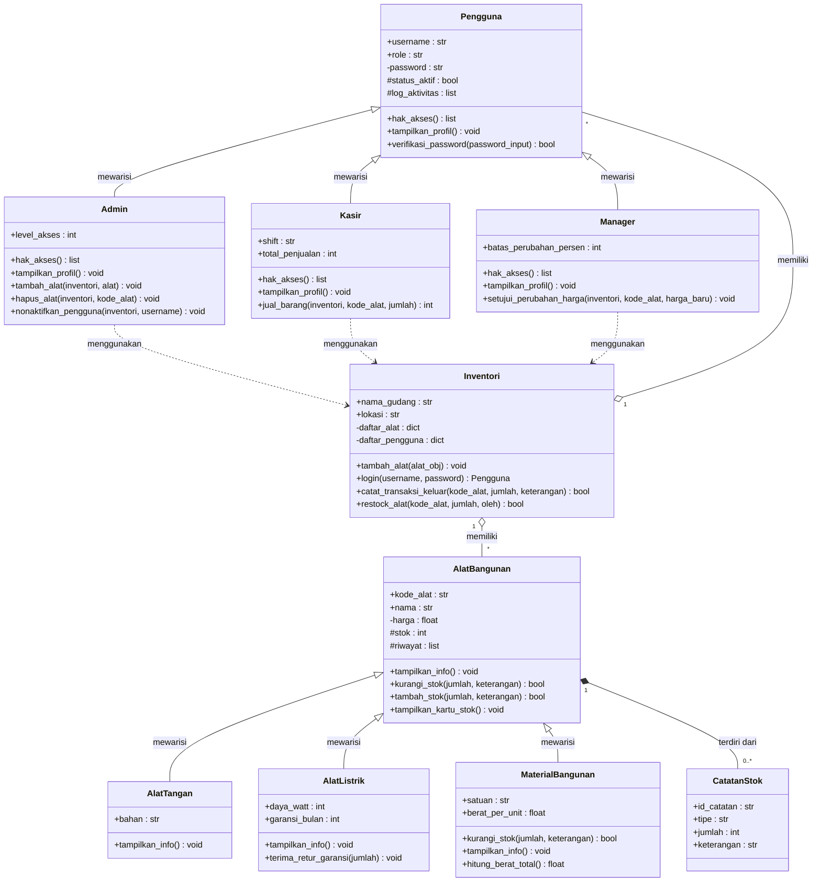

# Laporan Posttest 2 - Pemrograman Berorientasi Objek

**Judul:** Manajemen Inventori Alat Bangunan
**Nama:** Fathur Rahman
**NIM:** 2509106023
**File program:** `2509106023_FathurRahman.py`
**Materi:** Modul 4 (UML Class Relationships) dan Modul 5 (Inheritance)

---

## 1. Deskripsi Program

Program ini adalah sistem manajemen inventori untuk toko **CV Sumber Bangunan Jaya**. Program ini merupakan lanjutan dari Posttest 1 (kelas `Pengguna`, `AlatBangunan`, dan `Inventori`) yang kemudian dikembangkan dengan dua konsep baru:

1. **Relasi UML**: asosiasi, agregasi, dan komposisi.
2. **Inheritance**: superclass, subclass, `super()`, method overriding, serta atribut protected dan private.

Fitur utama:
- Login pengguna dengan hak akses berbeda untuk tiap role (Admin, Kasir, Manager).
- Tambah, cari, ubah harga, hapus, dan restock alat bangunan.
- Penjualan barang yang mengurangi stok dan mencatat total penjualan kasir.
- Kartu stok yang berisi riwayat mutasi masuk dan keluar tiap barang.

---

## 2. Struktur Kelas

| Kelas | Peran | Keterangan |
|---|---|---|
| `Pengguna` | Superclass | Akun pengguna dasar |
| `Admin` | Subclass dari `Pengguna` | Mengelola alat dan akun |
| `Kasir` | Subclass dari `Pengguna` | Melayani penjualan |
| `Manager` | Subclass dari `Pengguna` | Menyetujui perubahan harga |
| `AlatBangunan` | Superclass | Data dasar semua barang |
| `AlatTangan` | Subclass dari `AlatBangunan` | Palu, obeng, dan sejenisnya |
| `AlatListrik` | Subclass dari `AlatBangunan` | Bor, gerinda, dan sejenisnya |
| `MaterialBangunan` | Subclass dari `AlatBangunan` | Semen, paku, cat, dan sejenisnya |
| `CatatanStok` | Kelas bagian | Satu baris mutasi stok |
| `Inventori` | Kelas penampung | Gudang yang menampung alat dan pengguna |

---

## 3. Diagram UML



**Cara membaca:**
Inventori memiliki banyak AlatBangunan dan Pengguna (agregasi). AlatBangunan terdiri dari CatatanStok (komposisi). Admin, Kasir, dan Manager menggunakan Inventori (asosiasi). Admin, Kasir, dan Manager adalah Pengguna, sedangkan AlatTangan, AlatListrik, dan MaterialBangunan adalah AlatBangunan (pewarisan).

---

## 4. Penerapan Relasi UML (Modul 4)

### 4.1 Asosiasi ("menggunakan")
Objek `Inventori` diterima sebagai **parameter method** dan dipakai sementara. Pengguna tidak menyimpannya sebagai atribut, sehingga keduanya hidup mandiri.

```python
class Kasir(Pengguna):
    def jual_barang(self, inventori, kode_alat, jumlah):
        alat = inventori.ambil_alat(kode_alat)
        ...
        if inventori.catat_transaksi_keluar(kode_alat, jumlah, f"Penjualan oleh {self.username}"):
            ...
```

Contoh lain: `Admin.tambah_alat(inventori, alat)` dan `Manager.setujui_perubahan_harga(inventori, kode_alat, harga_baru)`.

### 4.2 Agregasi ("memiliki")
`Inventori` menampung referensi objek `AlatBangunan` dan `Pengguna` yang **dibuat di luar**, lalu didaftarkan lewat `tambah_alat()` dan `daftarkan_pengguna()`. Jika gudang dihapus, alat tetap ada.

```python
gudang_cabang.tambah_alat(paku)   # objek yang sama juga ada di gudang pusat
del gudang_cabang                 # gudang dibubarkan
paku.tampilkan_info()             # paku tetap ada
```

### 4.3 Komposisi ("terdiri dari")
`CatatanStok` **dibuat langsung di dalam** `AlatBangunan` lewat `_buat_catatan()`. Catatan tidak punya arti tanpa alat yang memilikinya, dan tidak dibagi ke alat lain.

```python
def _buat_catatan(self, tipe, jumlah, keterangan):
    id_baru = f"STK-{len(self._riwayat) + 1:04d}"
    self._riwayat.append(CatatanStok(id_baru, tipe, jumlah, keterangan))
```

### Ringkasan Relasi

| Relasi | Kelas | Bukti di kode |
|---|---|---|
| Asosiasi | Admin/Kasir/Manager dan Inventori | `Inventori` diterima sebagai parameter method |
| Agregasi | Inventori dan AlatBangunan/Pengguna | Objek dibuat di luar, `del gudang` tidak menghapus alat |
| Komposisi | AlatBangunan dan CatatanStok | Catatan dibuat di dalam `_buat_catatan()` |

---

## 5. Penerapan Inheritance (Modul 5)

### 5.1 Superclass dan Subclass

| Superclass | Subclass |
|---|---|
| `Pengguna` | `Admin`, `Kasir`, `Manager` |
| `AlatBangunan` | `AlatTangan`, `AlatListrik`, `MaterialBangunan` |

### 5.2 Penggunaan `super().__init__()`
Setiap subclass memanggil konstruktor superclass-nya.

```python
class Admin(Pengguna):
    def __init__(self, username, password, level_akses=1):
        super().__init__(username, password, "admin")
        self.level_akses = level_akses
```

### 5.3 Atribut Unik Tiap Subclass

| Subclass | Atribut unik |
|---|---|
| `Admin` | `level_akses` |
| `Kasir` | `shift`, `total_penjualan` |
| `Manager` | `batas_perubahan_persen` |
| `AlatTangan` | `bahan` |
| `AlatListrik` | `daya_watt`, `garansi_bulan` |
| `MaterialBangunan` | `satuan`, `berat_per_unit` |

### 5.4 Method Overriding

| Method | Superclass | Subclass yang meng-override |
|---|---|---|
| `hak_akses()` | `Pengguna` | `Admin`, `Kasir`, `Manager` (menambah izin sesuai role) |
| `tampilkan_profil()` | `Pengguna` | `Admin`, `Kasir`, `Manager` (menambah info khusus) |
| `tampilkan_info()` | `AlatBangunan` | `AlatTangan`, `AlatListrik`, `MaterialBangunan` |
| `kurangi_stok()` | `AlatBangunan` | `MaterialBangunan` (menambah info total berat keluar) |

```python
class MaterialBangunan(AlatBangunan):
    def kurangi_stok(self, jumlah, keterangan="Barang keluar"):
        berhasil = super().kurangi_stok(jumlah, keterangan)
        if berhasil:
            print(f"[INFO] Total berat keluar: {jumlah * self.berat_per_unit:,.0f} kg")
        return berhasil
```

### 5.5 Tingkat Akses (Protected dan Private)

| Atribut | Akses | Alasan |
|---|---|---|
| `_stok`, `_riwayat` (AlatBangunan) | Protected | Dimanipulasi langsung oleh subclass |
| `_status_aktif`, `_log_aktivitas` (Pengguna) | Protected | Dipakai oleh subclass untuk mencatat aktivitas |
| `__password` (Pengguna) | Private | Rahasia, hanya boleh diakses lewat property dan `verifikasi_password()` |
| `__harga` (AlatBangunan) | Private | Harus lewat setter yang tervalidasi (harus lebih dari 0) |

Contoh subclass memakai atribut protected secara langsung:

```python
class AlatListrik(AlatBangunan):
    def terima_retur_garansi(self, jumlah):
        self._stok += jumlah
        self._buat_catatan("MASUK", jumlah, "Retur klaim garansi")
```

Bukti atribut private tidak bisa diakses dari luar:

```text
Akses langsung ke atribut private gagal: 'Admin' object has no attribute '__password'
```

---

## 6. Hak Akses per Role

| Izin | Admin | Kasir | Manager |
|---|:---:|:---:|:---:|
| Lihat, cari alat, kartu stok | Ya | Ya | Ya |
| Tambah alat | Ya | - | - |
| Hapus alat | Ya | - | - |
| Kelola pengguna (nonaktifkan akun) | Ya | - | - |
| Restock | Ya | - | Ya |
| Ubah harga (disetujui manager) | - | - | Ya |
| Penjualan | - | Ya | - |

---

## 7. Cara Menjalankan

Kebutuhan: Python 3.

```bash
# Menjalankan seluruh demo otomatis
python3 2509106023_FathurRahman.py

# Menjalankan dengan login dan menu interaktif
python3 2509106023_FathurRahman.py interaktif
```

Akun untuk mode interaktif:

| Username | Password | Role |
|---|---|---|
| `admin1` | `rahasia123` | Admin |
| `manager1` | `5678` | Manager |
| `kasir1` | `0000` | Kasir (dinonaktifkan di demo 4, jadi tidak bisa login) |

---

## 8. Cuplikan Output

**Polimorfisme `tampilkan_profil()`**
```text
[USER] admin1 | Role: admin | Instansi: CV Sumber Bangunan Jaya
       Level akses: 2
[USER] kasir1 | Role: kasir | Instansi: CV Sumber Bangunan Jaya
       Shift: Siang | Total penjualan: Rp0
[USER] manager1 | Role: manager | Instansi: CV Sumber Bangunan Jaya
       Batas perubahan harga: 20%
```

**Method overriding `kurangi_stok()` pada MaterialBangunan**
```text
[OK] Stok 'Semen Gresik 40kg' berkurang 50. Sisa stok: 150
[INFO] Total berat keluar: 2,000 kg
```

**Asosiasi: kasir menjual lewat inventori**
```text
[OK] Stok 'Paku 5cm 1kg' berkurang 10. Sisa stok: 490
[INFO] Total berat keluar: 10 kg
[TRANSAKSI #1] Keluar 10 Paku 5cm 1kg dari 'Gudang Pusat'.
[STRUK] 10 x Paku 5cm 1kg @Rp19,000 = Rp190,000
```

**Batas wewenang manager**
```text
[GAGAL] Perubahan 57.9% melebihi batas wewenang manager (20%).
```

**Komposisi: kartu stok**
```text
[KARTU STOK] AB-001 - Semen Gresik 40kg (MaterialBangunan)
  Stok akhir: 130
    [STK-0001] MASUK  +200 | Ket: Stok awal
    [STK-0002] KELUAR -50 | Ket: Barang keluar
    [STK-0003] KELUAR -20 | Ket: Penjualan oleh kasir1
```

**Pengecekan pewarisan**
```text
isinstance(admin, Pengguna)      : True
isinstance(admin, Kasir)         : False
isinstance(bor, AlatBangunan)    : True
issubclass(AlatTangan, AlatBangunan): True
MRO MaterialBangunan: ['MaterialBangunan', 'AlatBangunan', 'object']
```

---

## 9. Kesimpulan

Program ini menerapkan seluruh ketentuan posttest. Tiga relasi UML (asosiasi, agregasi, komposisi) dan inheritance dengan dua superclass serta enam subclass dipakai bersamaan dalam satu sistem inventori yang utuh. Pemisahan akses protected dan private menjaga data penting (password dan harga) tetap aman, sedangkan data yang perlu dimanipulasi subclass (stok dan riwayat) tetap bisa diakses secara terkontrol.