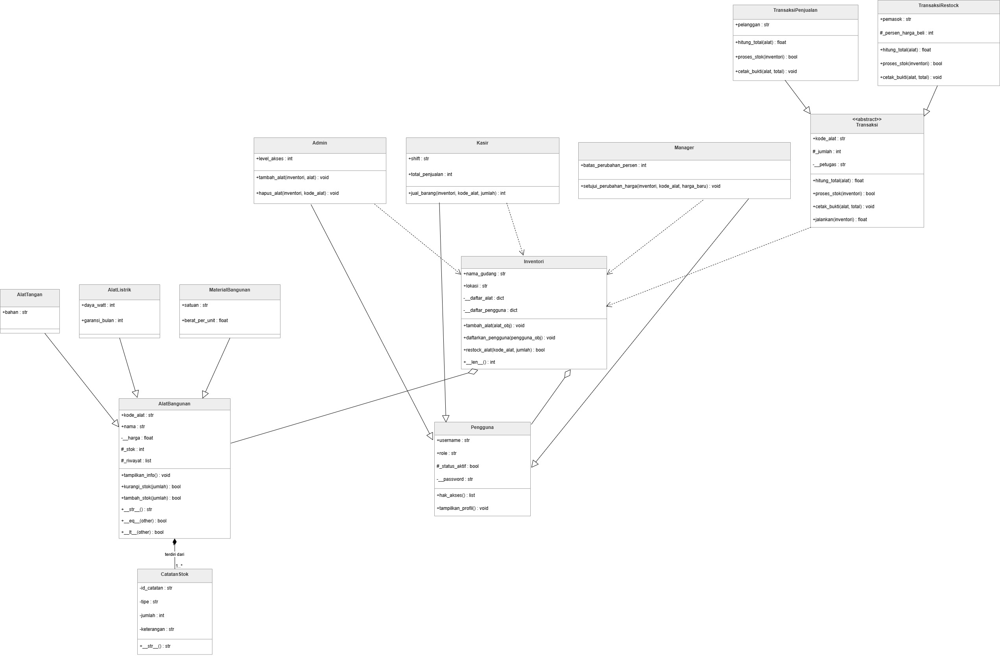
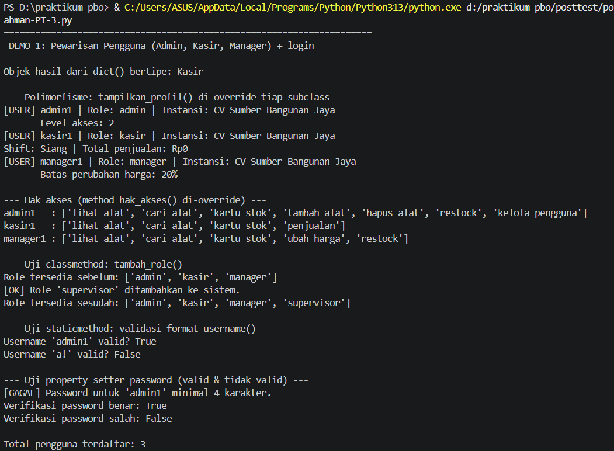
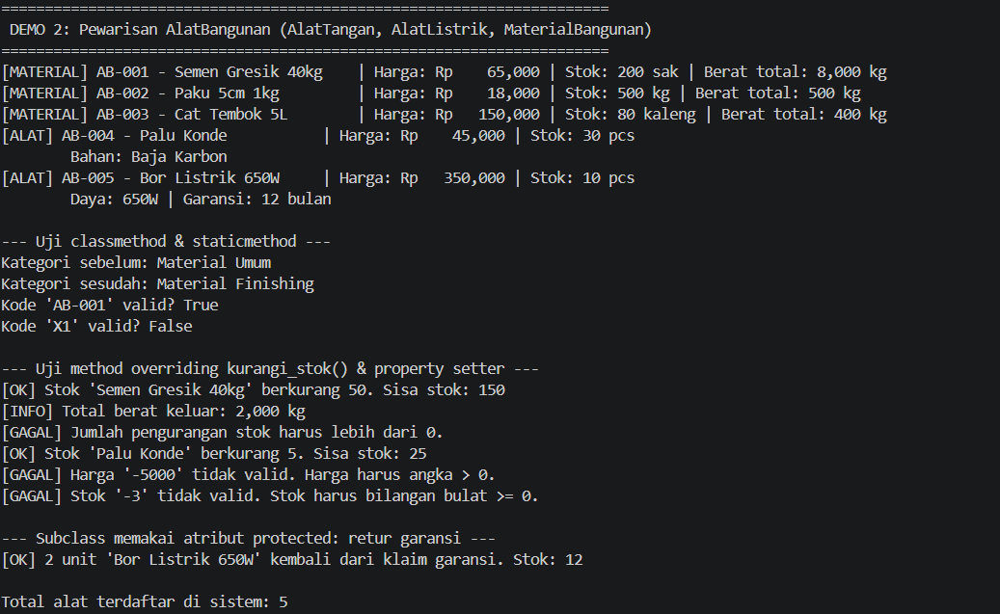
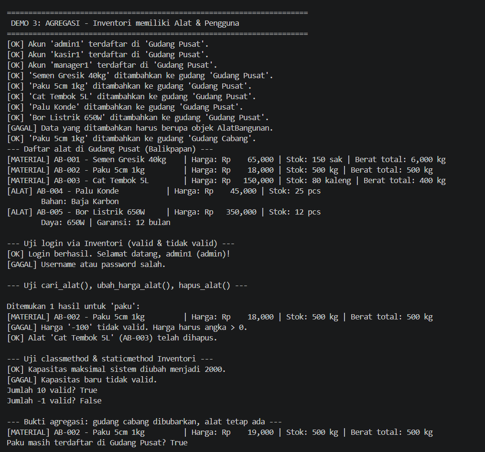
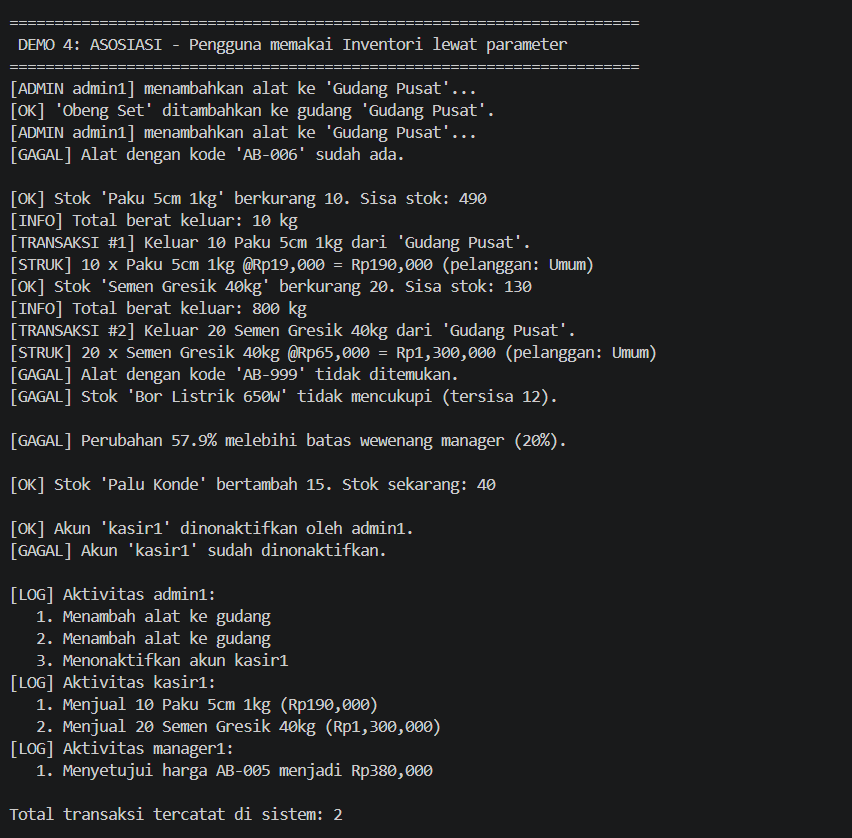
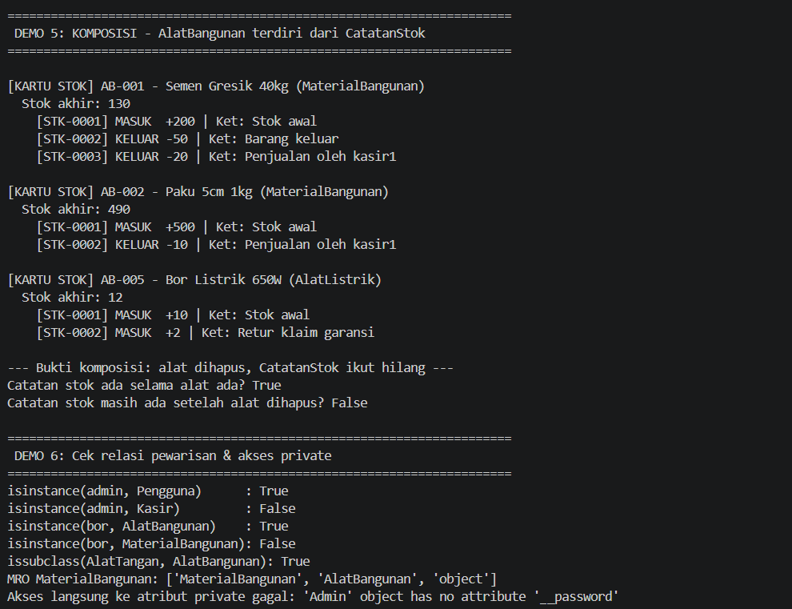
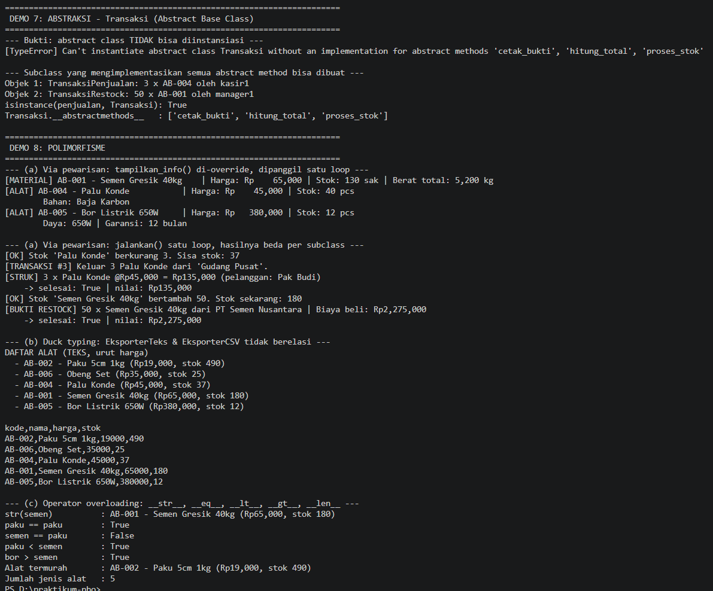

#  Posttest 3 PBO — Sistem Manajemen Inventori Alat Bangunan

| | |
|---|---|
| **Nama** | Fathur Rahman |
| **NIM** | 2509106023 |
| **Studi kasus** | Manajemen Inventori Alat Bangunan (CV Sumber Bangunan Jaya) |
| **File program** | `2509106023_FathurRahman.py` |

---

## Deskripsi Program

Program ini adalah sistem inventori untuk toko alat bangunan **CV Sumber Bangunan Jaya**. Tiga jenis pengguna (**Admin**, **Kasir**, **Manager**) login ke sistem, lalu mengelola barang di gudang sesuai hak aksesnya masing-masing:

| Role | Yang bisa dilakukan |
|---|---|
| **Admin** | Tambah alat, hapus alat, restock, menonaktifkan akun pengguna |
| **Kasir** | Menjual alat (menghasilkan struk) dan mencatat total penjualannya |
| **Manager** | Menyetujui perubahan harga (dibatasi persentase wewenang), restock |

Setiap perubahan stok selalu tercatat otomatis sebagai **kartu stok** (riwayat barang masuk/keluar) di tiap alat.

Posttest ini melanjutkan posttest sebelumnya (kelas `Pengguna`, `AlatBangunan`, `Inventori`, serta pewarisan). Tambahan di posttest 3:

-  **Abstraksi** — kelas abstrak `Transaksi` dengan subclass `TransaksiPenjualan` dan `TransaksiRestock`
-  **Polimorfisme** — override method, duck typing (`EksporterTeks` & `EksporterCSV`), dan operator overloading
-  **Class diagram UML** dengan relasi asosiasi, agregasi, dan komposisi yang benar-benar ada di kode
-  **Penerapan SOLID** (OCP & DIP) sebagai nilai plus


### Daftar Kelas

| Kelas | Peran | Induk |
|---|---|---|
| `Pengguna` | Akun pengguna (username, password private, status aktif, log aktivitas) | — |
| `Admin`, `Kasir`, `Manager` | Pengguna dengan hak akses & atribut unik masing-masing | `Pengguna` |
| `AlatBangunan` | Barang di gudang (kode, nama, harga private, stok protected, riwayat) | — |
| `AlatTangan`, `AlatListrik`, `MaterialBangunan` | Jenis alat dengan atribut unik (`bahan`; `daya_watt`/`garansi_bulan`; `satuan`/`berat_per_unit`) | `AlatBangunan` |
| `CatatanStok` | Satu baris mutasi stok (MASUK/KELUAR) | — |
| `Inventori` | Gudang yang menampung alat dan pengguna | — |
| `Transaksi` | **Abstract class** kerangka transaksi stok | `ABC` |
| `TransaksiPenjualan`, `TransaksiRestock` | Implementasi transaksi penjualan dan restock | `Transaksi` |
| `EksporterTeks`, `EksporterCSV` | Pengekspor daftar alat (untuk duck typing) | — |

---

## 1. Class Diagram & Relasi UML



**Legenda:** △ segitiga kosong = pewarisan · → panah terbuka = asosiasi · ◇ belah ketupat kosong = agregasi · ◆ belah ketupat penuh = komposisi

### Penjelasan Relasi

####  Asosiasi — `Admin` / `Kasir` / `Manager` → `Inventori`, dan `Transaksi` → `Inventori`
Kelas-kelas ini hanya **menggunakan** `Inventori` yang diterima lewat parameter method, tanpa menyimpannya sebagai atribut. Contohnya `Admin.tambah_alat(inventori, alat)`, `Kasir.jual_barang(inventori, kode, jumlah)`, dan `Transaksi.jalankan(inventori)`. Karena hubungannya sebatas "memakai" dan tidak ada kepemilikan, jenis relasinya asosiasi.

####  Agregasi — `Inventori` ◇— `AlatBangunan` dan `Inventori` ◇— `Pengguna`
Alat dan pengguna **dibuat di luar** `Inventori`, lalu didaftarkan lewat `tambah_alat()` dan `daftarkan_pengguna()`. `Inventori` hanya menampung referensinya, sehingga alat dan pengguna **tetap hidup walau gudangnya dibubarkan**. Buktinya di DEMO 3: `gudang_cabang` di-`del`, tetapi objek `paku` masih ada dan masih terdaftar di `gudang_pusat`.

####  Komposisi — `AlatBangunan` ◆— `CatatanStok`
Objek `CatatanStok` **dibuat di dalam** `AlatBangunan` (method `_buat_catatan()`) dan disimpan di `_riwayat`; tidak ada kode luar yang membuatnya. Catatan mutasi tidak punya arti tanpa alat pemiliknya, jadi **hidup-matinya bergantung pada alat**. Buktinya di DEMO 5: setelah objek alat di-`del`, `weakref` ke catatannya sudah kosong (catatan ikut hilang).

####  Kenapa agregasi vs komposisi?
- **Agregasi** dipilih jika bagian **bisa berdiri sendiri** dan hidup di luar keseluruhannya (alat dan pengguna sudah ada sebelum dan sesudah gudang).
- **Komposisi** dipilih jika bagian **sepenuhnya dimiliki** dan lahir-mati bersama keseluruhannya (catatan stok milik tepat satu alat).

---

## 2. Abstraksi

Kelas abstrak: **`Transaksi(ABC)`**

```python
class Transaksi(ABC):
    @abstractmethod
    def hitung_total(self, alat): ...
    @abstractmethod
    def proses_stok(self, inventori): ...
    @abstractmethod
    def cetak_bukti(self, alat, total): ...

    def jalankan(self, inventori):      
        ...
```

| Ketentuan | Penerapan di program |
|---|---|
| Minimal 1 abstract class (ABC) | `Transaksi(ABC)` |
| Minimal 2 `@abstractmethod` | **3 method:** `hitung_total()`, `proses_stok()`, `cetak_bukti()` |
| Minimal 2 subclass mengimplementasikan semuanya | `TransaksiPenjualan` dan `TransaksiRestock` |
| Minimal 1 method konkret bersama | `jalankan(inventori)` — alur tetap: cari alat → hitung total → proses stok → cetak bukti. Langkah yang berbeda diserahkan ke abstract method subclass |
| Bukti tidak bisa diinstansiasi | DEMO 7: `Transaksi(...)` menghasilkan `TypeError` (lihat output di bawah) |
| `super().__init__(...)` | Dipakai di `TransaksiPenjualan` dan `TransaksiRestock` |
| Atribut unik tiap subclass | `pelanggan` (Penjualan); `pemasok` dan `_persen_harga_beli` (Restock) |
| Protected / Private | `_jumlah`, `_selesai` (protected); `__petugas` (private, dibaca lewat `@property petugas`) |

Abstraksi ini benar-benar dipakai program: `Kasir.jual_barang()` membuat `TransaksiPenjualan`, dan menu restock interaktif memakai `TransaksiRestock`.

---

## 3. Polimorfisme

### a. Polimorfisme via pewarisan
| Method | Di-override oleh | Perilaku berbeda |
|---|---|---|
| `tampilkan_info()` | `AlatTangan`, `AlatListrik`, `MaterialBangunan` | Menampilkan bahan / daya & garansi / berat total |
| `jalankan()` → `hitung_total()`, `cetak_bukti()` | `TransaksiPenjualan`, `TransaksiRestock` | Struk penjualan (harga jual) vs bukti restock (biaya beli 70%) |
| `hak_akses()`, `tampilkan_profil()` | `Admin`, `Kasir`, `Manager` | Hak akses & profil berbeda per role |
| `kurangi_stok()` | `MaterialBangunan` | Menambahkan info total berat yang keluar |

Dipanggil dalam satu loop yang berisi objek dari subclass berbeda:

```python
for alat in (semen, palu, bor):          
    alat.tampilkan_info()

for transaksi in (penjualan, restock):   
    transaksi.jalankan(gudang_pusat)
```

### b. Duck typing
`EksporterTeks` dan `EksporterCSV` **tidak berelasi pewarisan**, tapi sama-sama punya method `ekspor(inventori)`. Keduanya dipanggil lewat satu fungsi yang sama:

```python
def cetak_ekspor(eksporter, inventori):
    print(eksporter.ekspor(inventori))

for eksporter in (EksporterTeks(), EksporterCSV()):
    cetak_ekspor(eksporter, gudang_pusat)
```

### c. Operator overloading
| Kelas | Magic method | Fungsi |
|---|---|---|
| `AlatBangunan` | `__str__` | Teks ringkas alat saat di-`print` |
| `AlatBangunan` | `__eq__` (+ `__hash__`) | Dua alat dianggap sama jika `kode_alat` sama |
| `AlatBangunan` | `__lt__` | Membandingkan harga; dipakai `sorted()` / `min()`, dan `>` ikut bekerja otomatis |
| `Inventori` | `__len__` | `len(gudang)` = jumlah jenis alat |
| `Transaksi`, `CatatanStok` | `__str__` | Teks ringkas transaksi / catatan |

### d. Larangan anti-pattern
Tidak ada rantai `if/elif` yang mengecek `type()` atau string jenis untuk membedakan perilaku objek: setiap objek menentukan perilakunya lewat method sendiri. Pemilihan jenis alat pada input interaktif pun memakai dictionary `PEMBANGUN_ALAT` (peta pilihan → fungsi pembangun), bukan `if/elif`.

---

## Nilai Plus: Prinsip SOLID

| Prinsip | Bagian program | Penjelasan |
|---|---|---|
| **OCP** (Open/Closed) | `Transaksi`, `cetak_ekspor()` | Menambah jenis transaksi baru (misal `TransaksiRetur`) cukup membuat subclass yang mengimplementasikan 3 abstract method, tanpa mengubah `Transaksi.jalankan()`. Menambah `EksporterJSON` juga tidak mengubah `cetak_ekspor()` |
| **DIP** (Dependency Inversion, via dependency injection) | `Kasir.jual_barang()`, `Admin.tambah_alat()`, `Transaksi.jalankan()`, `cetak_ekspor()` | `Inventori` dan eksporter **disuntikkan lewat parameter**, bukan dibuat di dalam kelas. `cetak_ekspor()` bergantung pada "apa pun yang punya `ekspor()`", bukan pada kelas eksporter tertentu |

---

## 4. Screenshot Output







---
